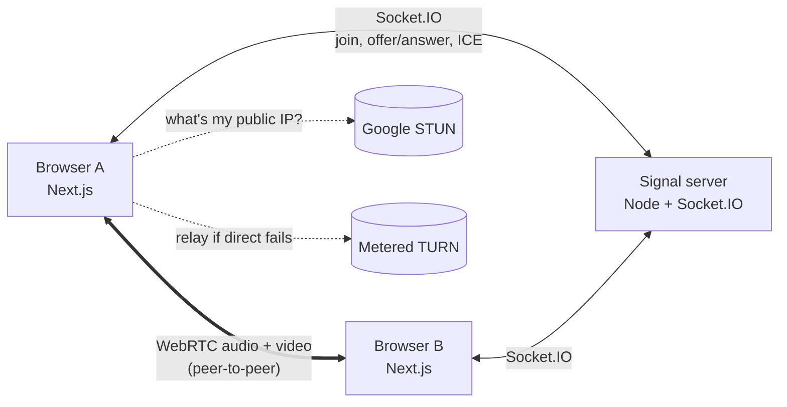

# Usap

Video calls with **live translated subtitles**. Two people join a call from a
browser (or, later, the Flutter app), each picks a language (English, Tagalog,
Cebuano/Bisaya, Japanese), and what one person says shows up as a subtitle on
the other person's screen in their language.

Built entirely on free tools: WebRTC, Socket.IO, Groq's free tier, and local
open-source models.

> **Status: Stage 1 of 6** — 1-on-1 video calls work. Subtitles, translation,
> mobile app, transcripts and summaries come in the next stages.

| Stage | What | Status |
| ----- | ---- | ------ |
| 1 | 1-on-1 browser video call (rooms, toggles, reconnect) | ✅ |
| 2 | Live same-language subtitles (VAD, Groq Whisper, rate limiter, local fallback) | ⏳ |
| 3 | Translation (NLLB-200) with per-user language | ⏳ |
| 4 | Flutter app joining the same calls | ⏳ |
| 5 | Postgres transcripts, AI summary, call history, auth | ⏳ |
| 6 | Tests, error states, deployment guide | ⏳ |

## Architecture (Stage 1)



- **Signal server** (`apps/signal`): introduces the two browsers to each other.
  It manages rooms and forwards WebRTC setup messages. It never sees audio or video.
- **Web app** (`apps/web`): the call UI. Audio and video go directly between the
  two browsers (or through the TURN relay when a direct path is blocked).

## Repo layout

```
usap/
  apps/web        Next.js + TypeScript + Tailwind call UI
  apps/signal     Node + TypeScript + Socket.IO signaling server
  packages/shared Type-only "contract" for the Socket.IO events (used by both)
  scripts/        gen-cert.mjs: self-signed HTTPS cert for testing on phones
  .env.example    Every setting, no secrets
```

## Setup

Requirements: **Node 22+** (developed on Node 24).

```bash
npm install
cp .env.example .env      # optional for Stage 1; add TURN credentials here
```

### Run on one computer (two tabs)

```bash
npm run dev
```

Open http://localhost:3000, click **Start a new call**, enter a name, join. Copy the
invite link into a second tab and join again. Use headphones or mute one tab,
otherwise the two tabs echo each other.

### Run across devices on the same Wi-Fi (laptop + phone)

Browsers only allow the camera on `https://` pages (or `localhost`), so a phone
opening `http://192.168.x.x:3000` would be blocked. Use HTTPS mode:

```bash
npm run dev:https
```

This creates a self-signed certificate in `certs/` (git-ignored) for localhost and
your laptop's LAN IPs, and serves both apps over HTTPS. The terminal prints the
LAN addresses. On the phone:

1. Open `https://<laptop-ip>:4000/health`, accept the certificate warning
   (Advanced → Proceed). You should see `{"ok":true,...}`.
2. Open `https://<laptop-ip>:3000`, accept the warning again, and join the call.

If Windows asks whether to allow Node.js on private networks, click **Allow**.

### TURN (optional, for calls across different networks)

STUN alone is enough on the same Wi-Fi. For calls across strict NATs/mobile
data, create a free [Metered](https://www.metered.ca/stun-turn) account and put
`METERED_APP_NAME` + `METERED_API_KEY` (or static `TURN_*` values) in `.env`. The
signal server hands these to browsers at runtime via `GET /ice-servers`, so they
never end up in the web bundle or in git.

## How a call connects

1. **Join.** Each browser connects to the signal server and sends `join-room`.
   Rooms hold at most 2 people.
2. **Offer/answer.** The newcomer creates an `RTCPeerConnection` and sends an
   *offer* (a description of the media it wants to send/receive). The other side
   replies with an *answer*. The server just forwards these messages.
3. **ICE.** Both sides discover possible network paths (local IP, public IP via
   STUN, relay via TURN) and trickle them to each other as *ICE candidates*.
4. **Media flows peer-to-peer.** From here on the server is not involved.

### Reconnect handling

| Problem | What happens |
| ------- | ------------ |
| Signal socket drops (Wi-Fi blip) | Socket.IO reconnects automatically and rejoins with the same `clientId`. The server kept the slot for 30 s, so the ongoing call is untouched (media is peer-to-peer). |
| Media path breaks (switched networks) | `connectionState` → `disconnected`/`failed` triggers an **ICE restart**: new network paths without ending the call. |
| Page reload | The old page tells the server it left (`pagehide`). If that message is lost, the server frees the "ghost" slot when the new page joins. |
| Both sides send an offer at the same time | **Perfect negotiation**: the "polite" peer backs off and accepts the other's offer. |

## Scripts

| Command | What it does |
| ------- | ------------ |
| `npm run dev` | Signal server (:4000) + web app (:3000) over HTTP |
| `npm run dev:https` | Same, over HTTPS for LAN/phone testing |
| `npm run typecheck` | TypeScript checks for both apps |
| `npm run lint` | ESLint for the web app |
| `npm run build` | Production build of both apps |
