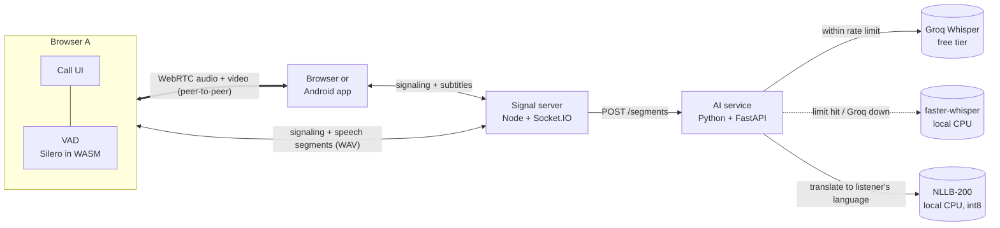

# Usap

Video calls with **live translated subtitles**. Two people join a call from a
browser (or, later, the Flutter app), each picks a language (English, Tagalog,
Cebuano/Bisaya, Japanese), and what one person says shows up as a subtitle on
the other person's screen in their language.

Built entirely on free tools: WebRTC, Socket.IO, Groq's free tier, and local
open-source models.

> **Status: Stage 4 of 6.** 1-on-1 video calls with live translated
> subtitles, in the browser and in an Android app. Transcripts and summaries
> come next.

| Stage | What | Status |
| ----- | ---- | ------ |
| 1 | 1-on-1 browser video call (rooms, toggles, reconnect) | ✅ |
| 2 | Live same-language subtitles (VAD, Groq Whisper, rate limiter, local fallback) | ✅ |
| 3 | Translation (NLLB-200) with per-user language | ✅ |
| 4 | Flutter app joining the same calls | ✅ |
| 5 | Postgres transcripts, AI summary, call history, auth | ⏳ |
| 6 | Tests, error states, deployment guide | ⏳ |

## Architecture



- **Signal server** (`apps/signal`): manages rooms, forwards WebRTC setup
  messages, forwards speech segments to the AI service and broadcasts the
  resulting subtitles. It never sees the video.
- **Web app** (`apps/web`): the call UI. Audio/video go directly between the
  two browsers (or via a TURN relay when a direct path is blocked).
- **AI service** (`apps/ai`): speech-to-text, then translation. Listens only on
  `127.0.0.1`, so only the signal server can reach it and the Groq key never
  leaves the server.

## Repo layout

```
usap/
  apps/web        Next.js + TypeScript + Tailwind call UI
  apps/signal     Node + TypeScript + Socket.IO signaling server
  apps/ai         Python + FastAPI speech-to-text + translation service
  apps/mobile     Flutter Android app (joins the same calls as the web app)
  packages/shared Type-only "contract" for the Socket.IO events (used by web + signal)
  scripts/        setup/run helpers (dev certificate, Python venv, VAD assets)
  .env.example    Every setting, no secrets
```

## Setup

Requirements: **Node 22+** and **Python 3.12**. For the Android app: **Flutter 3.x** and Android Studio (for the Android SDK).

```bash
npm install
npm run setup:ai          # creates apps/ai/.venv and installs Python packages
npm run setup:models      # one time: downloads + converts the NLLB translation model
cp .env.example .env      # then put your GROQ_API_KEY in .env
```

Get a free Groq key at https://console.groq.com → **API Keys** (no credit card).
Without a key everything still works, just slower: every segment uses the local model.

Downloads, once: the local Whisper model (~500 MB, on first start) and Meta's
NLLB model (~2.5 GB, during `setup:models`, converted to a ~600 MB int8 model in
`apps/ai/models/`). `setup:models` also installs PyTorch, which is only used for
that conversion.

> **Windows "Smart App Control" note:** the first time Python loads a freshly
> installed library, Windows may block it ("An Application Control policy has
> blocked this file"). It checks the file online and usually allows it on the
> next start. Run the command again.

> **Editing Python code?** Restart `npm run dev` afterwards. The AI service
> doesn't auto-reload: on Windows the old process can keep serving stale code.

### Run on one computer (two tabs)

```bash
npm run dev
```

Starts the signal server (:4000), the web app (:3000) and the AI service (:8000).
Open http://localhost:3000, click **Start a new call**, enter a name, join. Copy
the invite link into a second tab and join again. Use headphones or mute one
tab, otherwise the two tabs echo each other.

**Test subtitles without talking:** add `?fakeMic=/dev/sample-speech.wav` to a
room link (dev mode only). That tab "speaks" the sample file on a loop.

### Run across devices on the same Wi-Fi (laptop + phone)

Browsers only allow the camera on `https://` pages (or `localhost`), so a phone
opening `http://192.168.x.x:3000` would be blocked. Use HTTPS mode:

```bash
npm run dev:https
```

This creates a self-signed certificate in `certs/` (git-ignored) for localhost and
your laptop's LAN IPs. On the phone:

1. Open `https://<laptop-ip>:4000/health`, accept the certificate warning
   (Advanced → Proceed). You should see `{"ok":true,...}`.
2. Open `https://<laptop-ip>:3000`, accept the warning again, and join the call.

If Windows asks whether to allow Node.js on private networks, click **Allow**.

### TURN (optional, for calls across different networks)

STUN alone is enough on the same Wi-Fi. For calls across strict NATs/mobile
data, create a free [Metered](https://www.metered.ca/stun-turn) account and put
`METERED_APP_NAME` + `METERED_API_KEY` (or static `TURN_*` values) in `.env`. The
signal server hands these to browsers at runtime via `GET /ice-servers`.

## Android app (apps/mobile)

A Flutter app that speaks exactly the same Socket.IO protocol as the web app,
so a phone-app user and a browser user can call each other.

**Build and install** (Android phone with USB debugging on, connected by USB):

```bash
npm run dev:https                      # the servers, in one terminal
npm run build:mobile -- --install      # builds the APK and installs it on the phone
```

`build:mobile` bakes this laptop's Wi-Fi address in as the default server
(`https://<laptop-ip>:4000`). It can be changed on the app's home screen under
**Server**. The APK is at `apps/mobile/build/app/outputs/flutter-apk/app-debug.apk`
if you'd rather copy it to the phone yourself.

How it differs from the web app:

| | Web | Android app |
| --- | --- | --- |
| WebRTC | Browser API | `flutter_webrtc` (same libwebrtc underneath) |
| Voice detection | Silero neural net (WASM) | Energy-based VAD in pure Dart (`lib/speech/energy_vad.dart`) |
| Mic capture for subtitles | Cloned mic track | `record` package, "voice communication" source (shared with WebRTC, echo-cancelled) |
| Dev HTTPS certificate | Accept the warning once | Debug builds trust it, for the configured server host only |
| Extras | | Speakerphone on, screen kept awake, front/back camera switch |

The energy VAD compares each 30 ms frame's loudness (RMS) with a running
estimate of the background noise. It needs no model and almost no CPU; loud
non-speech sounds can slip through, and Whisper's no-speech filter on the
server catches most of those.

Signaling messages are processed strictly in order (a Future chain), because
`flutter_webrtc` calls cross into native code asynchronously and an ICE
candidate must never be applied before its offer.

Tests: `npm run test:mobile` (VAD, segment merging, WAV encoding, link parsing).

## How a call connects

1. **Join.** Each browser connects to the signal server and sends `join-room`.
   Rooms hold at most 2 people.
2. **Offer/answer.** The newcomer creates an `RTCPeerConnection` and sends an
   *offer*; the other side replies with an *answer*. The server just forwards them.
3. **ICE.** Both sides discover possible network paths (local IP, public IP via
   STUN, relay via TURN) and trickle them to each other as *ICE candidates*.
4. **Media flows peer-to-peer.** From here on the server is not involved.

### Reconnect handling

| Problem | What happens |
| ------- | ------------ |
| Signal socket drops (Wi-Fi blip) | Socket.IO reconnects and rejoins with the same `clientId`. The server kept the slot for 30 s, so the call is untouched (media is peer-to-peer). |
| Media path breaks (switched networks) | `connectionState` → `disconnected`/`failed` triggers an **ICE restart**: new network paths without ending the call. |
| Page reload | The old page tells the server it left (`pagehide`). If that message is lost, the server frees the "ghost" slot when the new page joins. |
| Both sides send an offer at once | **Perfect negotiation**: the "polite" peer backs off and accepts the other's offer. |

## How subtitles work

```
mic ─clone─▶ VAD (browser) ─▶ merge short bits ─▶ WAV ─▶ signal server ─▶ AI service ─▶ subtitle to both people
```

1. **Separate capture.** Each browser clones its own mic track. The clone feeds
   the subtitle pipeline; the original goes over WebRTC. Muting stops both.
2. **Voice activity detection.** [Silero VAD](https://github.com/ricky0123/vad)
   (a 2 MB neural net running in WebAssembly) marks each ~32 ms frame as speech or
   not. A segment ends after 0.5 s of silence, so silence is never uploaded.
3. **Merging.** Segments under 1 s wait up to 1.2 s to be joined with the next one.
   Fewer requests means less free-tier quota used.
4. **Upload.** The segment is encoded as a 16 kHz mono WAV and sent as a binary
   Socket.IO message. Only sent when someone else is in the call.
5. **Speech-to-text.** The AI service tries **Groq** (`whisper-large-v3-turbo`)
   first. If the rate limiter says no, or Groq fails, it uses **faster-whisper**
   locally. Every segment is logged with the engine, timing and reason:
   ```
   segment=f9ae194b-2 engine=groq audio=2.4s took=342ms lang=en text='...'
   segment=f9ae194b-9 engine=local (fallback: free-tier limit reached) audio=5.3s took=2157ms ...
   ```
6. **Broadcast.** The signal server sends `{ speakerId, originalText,
   translatedText, lang, timestamp, engine }` to everyone in the room. The
   speaker sees their own line too (smaller, as confirmation).

### Staying inside Groq's free tier

A **token bucket** per limit (requests/minute, requests/day, audio-seconds/hour,
audio-seconds/day) lives in [`apps/ai/app/rate_limiter.py`](apps/ai/app/rate_limiter.py).
A request is sent to Groq only if every bucket has room; otherwise it goes to
the local model. Groq bills each request as at least 10 s of audio, which the
limiter accounts for. If Groq still answers `429`, the service pauses Groq for
the `Retry-After` time. Current remaining quota: `GET http://127.0.0.1:8000/health`.

Typical latency: ~0.5 s of silence detection + 0.3 to 0.7 s on Groq, so a
subtitle appears about 1 s after you stop talking (2 to 3 s with the local model).

## How translation works

Each person picks **the language they speak** (English, Tagalog, Cebuano or
Japanese) before joining, and can change it during the call. Subtitles are
always shown in your own language.

1. The speaker's language is used as a **hint for Whisper**, which makes
   transcription more accurate than letting Whisper guess.
2. The signal server knows the listener's language and asks the AI service to
   translate into it with **NLLB-200** (Meta's "No Language Left Behind" model,
   distilled 600M version), running locally through **CTranslate2**.
3. The listener sees the translation (big) with the original underneath (small);
   the speaker sees what they said plus what the other person is reading.

Details that matter:

- **int8 quantization.** Meta's weights are converted once to 8-bit integers
  (`apps/ai/app/prepare_models.py`): 4x smaller and several times faster on a
  CPU, with nearly the same quality. A translation takes ~0.2 to 0.5 s.
- **One sentence at a time.** NLLB was trained on single sentences and silently
  drops sentences when given several at once, so text is split into sentences
  and translated as one batch.
- **Cache.** The last 512 translations are kept in memory; repeated short phrases
  ("Salamat", "Okay") cost nothing.
- **Cebuano.** Whisper has no Cebuano model. For Cebuano speakers it runs in
  Tagalog mode (closest language it knows: same spelling, many shared words)
  with a short Cebuano example as a prompt, which pulls the spelling toward
  Bisaya. NLLB itself does support Cebuano (`ceb_Latn`).
- **Fallback.** If translation fails, the listener still gets the original text.

Text-only translation endpoint, handy for testing:
```bash
curl -X POST http://127.0.0.1:8000/translate -H "Content-Type: application/json" -d "{\"text\":\"Kumusta ka?\",\"source\":\"tl\",\"target\":\"en\"}"
```

### Known limitations

- A subtitle appears when the speaker *pauses*; a long sentence without a
  pause shows up all at once at the end.
- Cebuano speech-to-text is a workaround (see above) and is the weakest link.
  A dedicated model such as Meta's MMS (which supports Cebuano) could replace it.
- Translation quality: NLLB is good with full sentences but can misread short,
  informal fragments and occasionally adds words (e.g. a polite closing in
  Japanese). Mixed Taglish works reasonably well.
- NLLB-200 is licensed **CC-BY-NC 4.0** (non-commercial), fine for a portfolio
  project; a commercial product would need a different translation model.
- Rate-limit counters are in memory, so restarting the AI service resets them
  (Groq's own `429` responses still protect you).

## Scripts

| Command | What it does |
| ------- | ------------ |
| `npm run setup:ai` | Create the Python venv and install AI packages |
| `npm run setup:models` | Download + convert the NLLB translation model (one time) |
| `npm run dev` | Signal (:4000) + web (:3000) + AI (:8000) over HTTP |
| `npm run dev:https` | Same, over HTTPS for LAN/phone testing |
| `npm run test:ai` | Python unit tests (rate limiter, languages, sentence splitting) |
| `npm run build:mobile` | Build the Android debug APK (`-- --install` to install over USB) |
| `npm run test:mobile` | Flutter unit tests |
| `npm run typecheck` | TypeScript checks for web + signal |
| `npm run lint` | ESLint for the web app |
| `npm run build` | Production build of web + signal |
