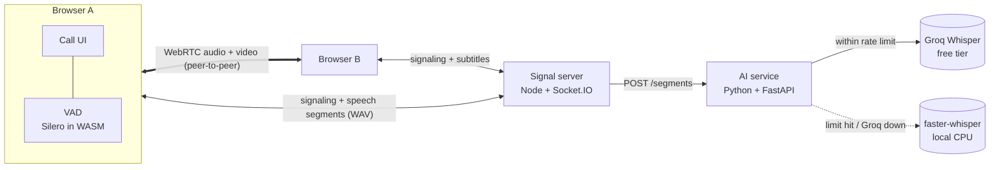

# Usap

Video calls with **live translated subtitles**. Two people join a call from a
browser (or, later, the Flutter app), each picks a language (English, Tagalog,
Cebuano/Bisaya, Japanese), and what one person says shows up as a subtitle on
the other person's screen in their language.

Built entirely on free tools: WebRTC, Socket.IO, Groq's free tier, and local
open-source models.

> **Status: Stage 2 of 6.** 1-on-1 video calls with live subtitles in the
> speaker's own language. Translation, the mobile app, transcripts and
> summaries come in the next stages.

| Stage | What | Status |
| ----- | ---- | ------ |
| 1 | 1-on-1 browser video call (rooms, toggles, reconnect) | ✅ |
| 2 | Live same-language subtitles (VAD, Groq Whisper, rate limiter, local fallback) | ✅ |
| 3 | Translation (NLLB-200) with per-user language | ⏳ |
| 4 | Flutter app joining the same calls | ⏳ |
| 5 | Postgres transcripts, AI summary, call history, auth | ⏳ |
| 6 | Tests, error states, deployment guide | ⏳ |

## Architecture



- **Signal server** (`apps/signal`): manages rooms, forwards WebRTC setup
  messages, forwards speech segments to the AI service and broadcasts the
  resulting subtitles. It never sees the video.
- **Web app** (`apps/web`): the call UI. Audio/video go directly between the
  two browsers (or via a TURN relay when a direct path is blocked).
- **AI service** (`apps/ai`): speech-to-text. Listens only on `127.0.0.1`, so
  only the signal server can reach it and the Groq key never leaves the server.

## Repo layout

```
usap/
  apps/web        Next.js + TypeScript + Tailwind call UI
  apps/signal     Node + TypeScript + Socket.IO signaling server
  apps/ai         Python + FastAPI speech-to-text service
  packages/shared Type-only "contract" for the Socket.IO events (used by web + signal)
  scripts/        setup/run helpers (dev certificate, Python venv, VAD assets)
  .env.example    Every setting, no secrets
```

## Setup

Requirements: **Node 22+** and **Python 3.12**.

```bash
npm install
npm run setup:ai          # creates apps/ai/.venv and installs Python packages
cp .env.example .env      # then put your GROQ_API_KEY in .env
```

Get a free Groq key at https://console.groq.com → **API Keys** (no credit card).
Without a key everything still works, just slower: every segment uses the local model.

The first start downloads the local Whisper model (~500 MB).

> **Windows "Smart App Control" note:** the first time Python loads a freshly
> installed library, Windows may block it ("An Application Control policy has
> blocked this file"). It checks the file online and usually allows it on the
> next start. Run the command again.

### Run on one computer (two tabs)

```bash
npm run dev
```

Starts the signal server (:4000), the web app (:3000) and the AI service (:8000).
Open http://localhost:3000, click **Start a new call**, enter a name, join. Copy
the invite link into a second tab and join again. Use headphones or mute one
tab, otherwise the two tabs echo each other.

**Test subtitles without talking:** add `?fakeMic=/dev/sample-speech.wav` to a
room link (dev mode only). That tab "speaks" the sample file on a loop.

### Run across devices on the same Wi-Fi (laptop + phone)

Browsers only allow the camera on `https://` pages (or `localhost`), so a phone
opening `http://192.168.x.x:3000` would be blocked. Use HTTPS mode:

```bash
npm run dev:https
```

This creates a self-signed certificate in `certs/` (git-ignored) for localhost and
your laptop's LAN IPs. On the phone:

1. Open `https://<laptop-ip>:4000/health`, accept the certificate warning
   (Advanced → Proceed). You should see `{"ok":true,...}`.
2. Open `https://<laptop-ip>:3000`, accept the warning again, and join the call.

If Windows asks whether to allow Node.js on private networks, click **Allow**.

### TURN (optional, for calls across different networks)

STUN alone is enough on the same Wi-Fi. For calls across strict NATs/mobile
data, create a free [Metered](https://www.metered.ca/stun-turn) account and put
`METERED_APP_NAME` + `METERED_API_KEY` (or static `TURN_*` values) in `.env`. The
signal server hands these to browsers at runtime via `GET /ice-servers`.

## How a call connects

1. **Join.** Each browser connects to the signal server and sends `join-room`.
   Rooms hold at most 2 people.
2. **Offer/answer.** The newcomer creates an `RTCPeerConnection` and sends an
   *offer*; the other side replies with an *answer*. The server just forwards them.
3. **ICE.** Both sides discover possible network paths (local IP, public IP via
   STUN, relay via TURN) and trickle them to each other as *ICE candidates*.
4. **Media flows peer-to-peer.** From here on the server is not involved.

### Reconnect handling

| Problem | What happens |
| ------- | ------------ |
| Signal socket drops (Wi-Fi blip) | Socket.IO reconnects and rejoins with the same `clientId`. The server kept the slot for 30 s, so the call is untouched (media is peer-to-peer). |
| Media path breaks (switched networks) | `connectionState` → `disconnected`/`failed` triggers an **ICE restart**: new network paths without ending the call. |
| Page reload | The old page tells the server it left (`pagehide`). If that message is lost, the server frees the "ghost" slot when the new page joins. |
| Both sides send an offer at once | **Perfect negotiation**: the "polite" peer backs off and accepts the other's offer. |

## How subtitles work

```
mic ─clone─▶ VAD (browser) ─▶ merge short bits ─▶ WAV ─▶ signal server ─▶ AI service ─▶ subtitle to both people
```

1. **Separate capture.** Each browser clones its own mic track. The clone feeds
   the subtitle pipeline; the original goes over WebRTC. Muting stops both.
2. **Voice activity detection.** [Silero VAD](https://github.com/ricky0123/vad)
   (a 2 MB neural net running in WebAssembly) marks each ~32 ms frame as speech or
   not. A segment ends after 0.5 s of silence, so silence is never uploaded.
3. **Merging.** Segments under 1 s wait up to 1.2 s to be joined with the next one.
   Fewer requests means less free-tier quota used.
4. **Upload.** The segment is encoded as a 16 kHz mono WAV and sent as a binary
   Socket.IO message. Only sent when someone else is in the call.
5. **Speech-to-text.** The AI service tries **Groq** (`whisper-large-v3-turbo`)
   first. If the rate limiter says no, or Groq fails, it uses **faster-whisper**
   locally. Every segment is logged with the engine, timing and reason:
   ```
   segment=f9ae194b-2 engine=groq audio=2.4s took=342ms lang=en text='...'
   segment=f9ae194b-9 engine=local (fallback: free-tier limit reached) audio=5.3s took=2157ms ...
   ```
6. **Broadcast.** The signal server sends `{ speakerId, originalText,
   translatedText, lang, timestamp, engine }` to everyone in the room. The
   speaker sees their own line too (smaller, as confirmation).

### Staying inside Groq's free tier

A **token bucket** per limit (requests/minute, requests/day, audio-seconds/hour,
audio-seconds/day) lives in [`apps/ai/app/rate_limiter.py`](apps/ai/app/rate_limiter.py).
A request is sent to Groq only if every bucket has room; otherwise it goes to
the local model. Groq bills each request as at least 10 s of audio, which the
limiter accounts for. If Groq still answers `429`, the service pauses Groq for
the `Retry-After` time. Current remaining quota: `GET http://127.0.0.1:8000/health`.

Typical latency: ~0.5 s of silence detection + 0.3 to 0.7 s on Groq, so a
subtitle appears about 1 s after you stop talking (2 to 3 s with the local model).

### Known limitations

- A subtitle appears when the speaker *pauses*; a long sentence without a
  pause shows up all at once at the end.
- Whisper has no Cebuano model. Bisaya speech will be transcribed poorly until
  Stage 3 adds language hints (it often comes out as Tagalog-like text).
- Rate-limit counters are in memory, so restarting the AI service resets them
  (Groq's own `429` responses still protect you).

## Scripts

| Command | What it does |
| ------- | ------------ |
| `npm run setup:ai` | Create the Python venv and install AI packages |
| `npm run dev` | Signal (:4000) + web (:3000) + AI (:8000) over HTTP |
| `npm run dev:https` | Same, over HTTPS for LAN/phone testing |
| `npm run test:ai` | Python unit tests (rate limiter) |
| `npm run typecheck` | TypeScript checks for web + signal |
| `npm run lint` | ESLint for the web app |
| `npm run build` | Production build of web + signal |
